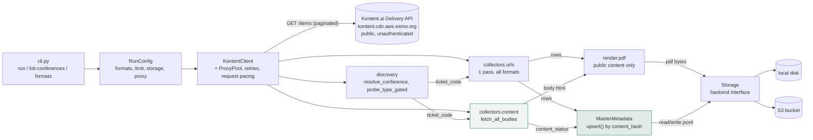
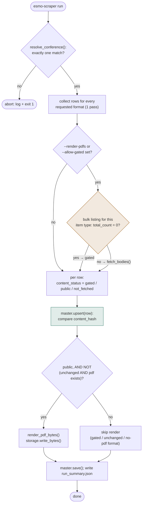

# ESMO OncologyPRO Scraper — Case Study

**A dynamic, production-grade collector for ESMO's congress resources site, built by reverse-engineering its backend API instead of automating 400+ pages of UI clicks.**

## The problem

[oncologypro.esmo.org](https://oncologypro.esmo.org) publishes abstracts, posters, and slides for every ESMO medical conference. The brief: collect every abstract URL (and ideally a PDF) for a given congress — starting with ESMO Congress 2026, which has **4,410 abstracts**.

The obvious approach — paginate the listing UI, 10 results per page — meant **441 page loads** per congress, per run, with no way to tell afterward what had changed since last time.

## The investigation

Instead of automating the UI, I inspected how the page itself gets its data:

1. The site is a client-rendered Nuxt app — no server-rendered HTML, no sitemap entry per abstract, so a plain fetch of the listing page returns an empty shell.
2. Its inline `window.__NUXT__.config` exposes a **public, unauthenticated Kontent.ai Delivery API** (`kontent.cdn.aws.esmo.org`) — the same one the frontend calls after the page mounts.
3. Reverse-engineered the query shape from the compiled JS bundles: conferences are a taxonomy tag (`security__ticket_code`) on `presentation` items; the site's "Abstract" filter is just `elements.abstract[nempty]`. Confirmed against the live API: `total_count: 4410` — exact match to the page's own counter.
4. Result: **4,410 records in 9 paginated requests**, instead of 441 browser page loads.
5. Went one step further: the linked `abstract` content item carries the **full abstract text as HTML** (Background/Methods/Results/Conclusions) — so real PDFs could be rendered locally, since the site itself has no literal PDF file per abstract.
6. Tried the same approach for posters (eposters) and slides, and found a second, more interesting result: those content types are tagged `Members`/`Tickets`-only, and **the API's own listing endpoint silently excludes gated content from bulk queries** (`total_count: 0`) even though a direct per-codename fetch still confirms the item exists. The tool treats an empty listing as the signal that a format is access-gated for that conference, and stops there — it never logs in or carries a session to get around it.

## From script to system

The first working version was a single script. Turning it into something reusable for **any** ESMO congress and **any** format meant answering: what happens the second time someone runs this? Against a different conference? Selecting posters and slides alongside abstracts? From a CI job instead of a laptop?

### Architecture

Every API call goes through **one client** that owns proxy rotation, retries, and pacing — discovery and both collectors share it rather than each making raw requests. Everything that writes output goes through **one storage interface**, so `--storage local` vs `--storage s3` changes nothing upstream of it.

### Run orchestration — the two decisions that matter

- **Idempotency** — a `content_hash` per record (excluding run-bookkeeping fields) means re-running the same conference only touches rows that are actually new or changed; a second run against the same scope showed `"unchanged": 4, pdfs_rendered: 0` against the first run's `"new": 4`.
- **Access boundaries respected by construction** — gated formats are detected per-conference (not hardcoded by format name) and recorded with URL + metadata only, never downloaded. No login, no session, no workaround.

### Production concerns

| Concern | How it's handled |
|---|---|
| **Dynamic scope** | Conferences and format availability are discovered live from the API (`list-conferences`, `formats`) — nothing about a specific congress is hardcoded. |
| **Observability** | Every run gets a `run_id` tagging a human-readable `run.log`, a structured `run.jsonl` (ready for CloudWatch/Datadog/`jq`), and a `run_summary.json` with counts and timing. |
| **Storage** | A `StorageBackend` interface with `local` and `s3` implementations — same relative paths become S3 keys; AWS credentials come from boto3's normal chain, never from app config. |
| **Proxy** | Single proxy or a round-robin pool from a file, with dead-proxy retirement; pacing stays fixed regardless, since proxies are for egress routing, not rate-limit evasion. |
| **Idempotent re-runs** | `master_metadata.jsonl` is cumulative per conference; `{run_id}/` snapshots are kept per run for audit. |
| **Terms of use** | Abstract content is copyrighted (ESMO / Annals of Oncology); the tool documents this and distinguishes personal/research use from redistribution, which needs ESMO's written permission. |

## Results

- **4,410** abstract URLs + metadata collected in **9 API requests** (vs. 441 UI page loads).
- **4,410 PDFs** rendered locally from API content, **0 errors**.
- **Dynamic discovery** validated live: found every past ESMO Congress (2021/2023/2024/2025/2026) plus adjacent congress series, with zero code changes.
- **Gating detection** validated live: 7/7 test eposter rows correctly flagged `gated` with zero wasted requests, vs. 7/7 abstract rows rendered.

## Stack

Python 3.11 · `requests` (retry/backoff via `urllib3.Retry`) · `reportlab` (PDF rendering) · `boto3` (optional S3 backend) · stdlib `logging` (structured JSON logs) · no scraping framework, no headless browser in the hot path — this is a typed HTTP client against a reverse-engineered JSON API.

## What's next

- Swap the per-presentation hash for the API's own `last_modified` timestamp as a cheaper pre-filter before hashing.
- Add a CloudWatch EMF emitter alongside the JSON log sink for native AWS dashboards.
- Generalize `FORMAT_FIELD_MAP` discovery (currently a fixed map of known fields) by introspecting the Kontent.ai content-type schema endpoint directly.
